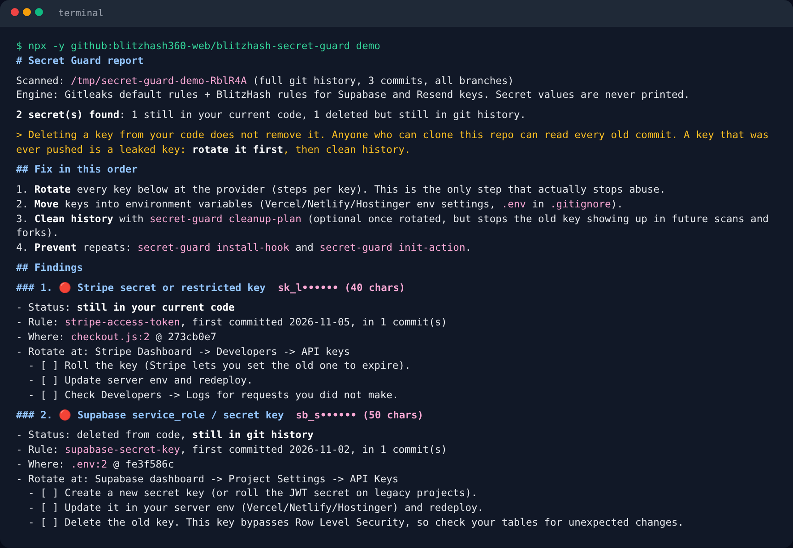

# BlitzHash Secret Guard

**Deleted your `.env` after pushing it? The key is still in your git history. Find every leaked key, rotate it, clean up, and stop the next one: one command.**

[](https://github.com/blitzhash360-web/blitzhash-secret-guard/actions/workflows/ci.yml)
[](LICENSE)


Apps built with Lovable, Bolt, Replit, Cursor or v0 leak keys in the same way: the first version ships with a Supabase or Stripe key in the code or a committed `.env`, someone notices, the file gets deleted, and everyone assumes it's fixed. It isn't. Every old commit is still there for anyone who can clone the repo.

Secret Guard scans **every commit on every branch**, tells you which keys are still in your code and which are "deleted but still in history", gives you the exact rotation steps for each provider, writes a safe history cleanup plan, and installs a pre-commit hook and a GitHub Action so it doesn't happen again.



## Quick start

```bash
# 1. See it work on a throwaway repo with FAKE planted keys (Node 18+, macOS or Linux):
npx -y github:blitzhash360-web/blitzhash-secret-guard demo

# 2. Scan your own project's full history and save the report:
npx -y github:blitzhash360-web/blitzhash-secret-guard scan . --out SECRET-GUARD-REPORT.md

# 3. Rotate every 🔴 key first (steps are in the report), then block new leaks:
npx -y github:blitzhash360-web/blitzhash-secret-guard install-hook
```

No Gitleaks installed? Secret Guard downloads the official Gitleaks release for your machine, checks it against the official SHA-256 checksums and caches it in `~/.cache/blitzhash-secret-guard`. Already have Gitleaks on your PATH (or `GITLEAKS_BIN` set)? It uses yours. On Windows, install Gitleaks first (`winget install gitleaks` or `scoop install gitleaks`).

## What you get

| Command | What it does | Changes anything? |
|---|---|---|
| `scan [path]` | Full-history scan (all branches) or a plain folder. Groups each unique key, marks it **still in current code** or **deleted, still in history**, shows first commit date, files and commits, and per-provider rotation steps. Exits 1 if anything is found (`--no-fail` to override). | No |
| `demo` | Builds a temp repo with fake keys (one deleted, one live), scans it, deletes it. | No (temp only) |
| `cleanup-plan [path]` | Step-by-step plan: rotate first, mirror backup, `git filter-repo --replace-text`, rescan, force-push, what to tell collaborators, GitHub cached views and PR refs, host build caches. | No |
| `cleanup-plan --write-replacements <file>` | Also writes the filter-repo replacements file (it contains the raw secrets, so it's created with mode 600; keep it outside the repo and delete it after). | Writes that one file |
| `install-hook [path]` | Pre-commit hook that runs Gitleaks on **staged changes only** and blocks the commit with a plain-English message. Won't overwrite an existing hook without `--force` (keeps a `.bak`). | Adds `.git/hooks/pre-commit` |
| `init-action [path]` | Adds `.github/workflows/secret-guard.yml`: full-history scan on every push and pull request, report in the job summary. | Adds one workflow file |
| `staged [path]` | Scan staged changes only. | No |

### Detection

- All ~220 default [Gitleaks](https://github.com/gitleaks/gitleaks) rules (Stripe, OpenAI, Anthropic, AWS, GitHub, Google, Slack, SendGrid, Twilio, private keys, JWTs and many more).
- Plus BlitzHash rules for keys AI-built apps leak most that the defaults don't name: Supabase `sb_secret_` keys, legacy Supabase `service_role` JWTs (recognised by the role claim, so you see "bypasses Row Level Security", not just "a JWT"), Supabase personal access tokens (`sbp_`) and Resend API keys. See [`src/gitleaks-extra.toml`](src/gitleaks-extra.toml).
- Secret values are never printed or written to the report: you see the first 4 characters and the length. The Gitleaks JSON report goes to a private temp folder and is deleted straight after.

## GitHub Action

```yaml
# .github/workflows/secret-guard.yml  (or run: npx -y github:blitzhash360-web/blitzhash-secret-guard init-action)
name: Secret Guard
on: [push, pull_request]
permissions:
  contents: read
jobs:
  secrets:
    runs-on: ubuntu-latest
    steps:
      - uses: actions/checkout@v4
        with:
          fetch-depth: 0   # full history, so old leaks are caught too
      - uses: blitzhash360-web/blitzhash-secret-guard@v1
        # with:
        #   path: .
        #   fail: true
```

It runs the Gitleaks binary directly, so no Gitleaks Action license key is needed.

## Agent skill

[`skills/secret-guard/SKILL.md`](skills/secret-guard/SKILL.md) lets Claude Code, Cursor, Codex or any AGENTS.md tool walk you through it: scan, explain, guide rotation, move keys to env vars, and only rewrite history after you confirm.

```bash
# Claude Code
mkdir -p .claude/skills && cp -r skills/secret-guard .claude/skills/
# Cursor / other agents: copy SKILL.md into your rules folder or reference it from AGENTS.md
```

Then ask: *"Did I ever leak a key in this repo?"*

## Key rotation checklist

[`docs/key-rotation.md`](docs/key-rotation.md): where to rotate Supabase, Stripe, OpenAI, Anthropic, AWS, Google, GitHub, email and Twilio keys, and what to check afterwards.

## Going to production? What this doesn't cover

Secret Guard finds and stops leaked keys. It doesn't:

- Check what a leaked key was **used for** while it was public (provider logs, database changes, unexpected Auth users, cloud bills).
- Move you to **short-lived credentials** (OIDC for CI, scoped service accounts, secret managers) so a leak matters less.
- Audit the rest of an AI-built app: Supabase tables without RLS, unsigned Stripe webhooks, API routes with no auth check, missing rate limits. For that, try [blitzhash-security-review](https://github.com/blitzhash360-web/blitzhash-security-review).
- Plan a **history rewrite across a team** with open PRs, forks, mirrors and deploy pipelines without breaking anything.

That's the part a senior team does. **BlitzHash offers a free assessment: https://blitzhash.com**

## Credits

- **[Gitleaks](https://github.com/gitleaks/gitleaks)** by Zachary Rice and contributors (MIT) is the detection engine. Secret Guard calls the official Gitleaks binary; no Gitleaks code is copied or modified. Gitleaks' default rules are used as-is through `useDefault = true`.
- **[git-filter-repo](https://github.com/newren/git-filter-repo)** (MIT) is the history rewrite tool the cleanup plan uses (not bundled).
- History cleanup steps follow GitHub's "Removing sensitive data from a repository" guide.

Secret Guard is independent and not affiliated with or endorsed by Gitleaks, Supabase, Stripe or any provider mentioned.

## License

MIT for BlitzHash code. Gitleaks and git-filter-repo keep their own MIT licenses.

---

**Built by BlitzHash: need a senior team to check or scale your AI-built app? Free assessment at https://blitzhash.com**
